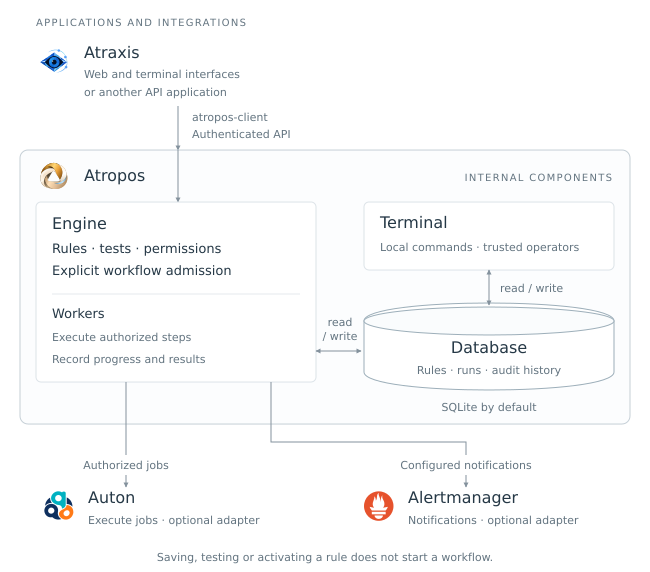

# Atropos

<picture>
  <source media="(prefers-color-scheme: dark)" srcset="assets/brand/svg/atropos-logo-horizontal.svg">
  
</picture>

**A standalone rule and workflow engine: test a decision, explicitly authorize a
workflow, and track every step through completion or an uncertain outcome.**

Atropos **1.0.0** is free software under GPL-3.0-only. It runs on your own
infrastructure, independently of Atraxis and without an AI provider. Atraxis can
supply its web and terminal interfaces; Atropos owns the rules, permissions,
storage and workflow execution.

[Website](https://atraxis.io/#atropos) · [Engine on PyPI](https://pypi.org/project/atraxis-atropos/1.0.0/) ·
[Client on PyPI](https://pypi.org/project/atropos-client/1.0.0/) ·
[User guide](docs/user/README.md) · [Contributing](docs/contributor/README.md) · [Roadmap](ROADMAP.md)

## What can you do with it?

- **Manage decision rules:** create YAML drafts, keep immutable revisions, test
  concrete scenarios and explicitly activate a tested version. The documented
  version-1 rule model uses ZEN 2.1.2.
- **Run bounded workflows:** validate a graph, submit it with a deduplication key,
  advance it through workers, inspect persisted results and reconcile uncertainty.
- **Control who can act:** the rule service checks organization, group, resource
  and operation scopes at admission and again before execution.
- **Connect approved executors:** use registered actions or an explicitly configured
  Auton adapter. Optional Alertmanager delivery reports workflow outcomes.
- **Operate persistent state:** start with SQLite and its integrated queue; choose
  other documented storage/delivery adapters when needed.

For example, an operator can test a CPU decision rule and then explicitly dispatch
an approved diagnostic for the affected target. Saving, testing or activating a
rule does not start that diagnostic. Collection, decision and execution remain
separate operations.

## How the components fit together



**Inside Atropos**, the engine and local terminal read and write the configured
persistent storage. The database cylinder holds rule versions and tests, workflow
runs and results, and audit history. SQLite is the default: a local file, with no
separate database server required. Other storage adapters are documented in the
[backend guide](docs/user/backends.md). The frame indicates component ownership,
not a requirement to run everything in one process, container or host.

The **Atropos terminal** is the local `atropos` command for trusted operators:
validate, submit, run and inspect workflows. Its built-in actions are registered
demo actions. The authenticated rule service and its guarded workers provide
scoped rule-driven dispatch. The terminal and service share data only when
configured to use the same storage and namespace.

Coloured logos identify optional external software: **Atraxis** connects through
`atropos-client` and the authenticated API; **Auton** executes authorized jobs;
**Alertmanager** routes configured notifications. Saving, testing or activating a
rule does not automatically launch a workflow.

| Software | Role | Required? |
| --- | --- | --- |
| **Atropos** (`atraxis-atropos`) | Engine, local CLI and optional HTTP rule service | The component installed here |
| [Atropos client](client/README.md) (`atropos-client`) | Independent Python API client | For API consumers; installed by the engine's `service` extra |
| [Atraxis](https://github.com/decryptus/atraxis) | Inventory, web and terminal operator interfaces | Optional; Atropos works without it |
| [Auton](https://github.com/decryptus/auton) | Execute explicitly authorized jobs | Optional execution adapter |
| [Alertmanager](https://github.com/prometheus/alertmanager) | Route and deliver configured notifications | Optional notification adapter |
| [monit-docker](https://github.com/decryptus/monit-docker) / [CertLord](https://github.com/decryptus/certlord) | Container monitoring / certificate lifecycle | Independent tools; observations can be supplied through Atraxis |
| [AnySQL](https://github.com/decryptus/anysql) | Connection layer used by SQL adapters | Relevant to SQL backend configuration |

Prometheus and Covenant are not required to run Atropos. Monit-Docker retains its
own monitoring, local actions and protections when used alongside Atropos.

## Start here

The [supported reference](docs/user/v1.0.md) covers Linux amd64 and Python 3.11/3.12.
On Debian/Ubuntu, install the system `libmagic1` library and Python's venv support:

```sh
sudo apt-get install python3-venv libmagic1
python3 -m venv .venv
. .venv/bin/activate
python -m pip install 'atraxis-atropos==1.0.0'
python -m pip check
atropos --help
```

The PyPI distribution is named **`atraxis-atropos`**; the command and Python module
are **`atropos`**. The unrelated PyPI package named `atropos` is not this engine.

### Run a harmless first workflow

Create a file in an empty working directory. This single step returns its inputs;
it does not contact a service or modify a supervised resource:

```sh
cat > hello.yml <<'YAML'
version: 1
name: hello
start: report
steps:
  report:
    action: core.echo
    with:
      message: Hello from Atropos
YAML

export ATROPOS_STORAGE_BACKEND=sqlite
export ATROPOS_STORAGE_URL=sqlite:///atropos.db
atropos validate hello.yml
atropos plan hello.yml
atropos submit hello.yml --target demo-node --dedup-key hello-001
atropos worker --once
```

Copy the run ID returned by `submit`, then inspect it with `atropos status RUN_ID`.
For this one-step example, a successful worker completes the run. In a multi-step
workflow, `worker --once` attempts one step per configured worker; use `atropos
worker` for continuous processing. Submission means queued, not completed.

### Run the rule service

In a dedicated engine environment, install the service dependencies:

```sh
python -m pip install 'atraxis-atropos[service]==1.0.0'
```

Follow the [rule service guide](docs/user/rule-service.md) to create the private
profile, provision identities and permissions, configure storage and verified
HTTPS, then start the loopback listener:

```sh
atropos rules-serve --config /private/atropos-service.yml --port 8082
```

The profile path is an example, not a bundled ready-to-use configuration. Installing
the package does not start the service, create credentials or authorize actions.

### Install only the API client

In the consuming application's separate environment:

```sh
python -m pip install 'atropos-client==1.0.0'
```

The base client does not install the engine, Redis or ZEN. Add `[observations]`
when that application needs signed observation envelopes. Follow its own dependency
pins: Atraxis 1.0.0 still pins client 0.1.0a10, whose functional code matches 1.0.0
apart from the version constant. Do not override that pin inside Atraxis's environment.

### Install from source instead

```sh
git clone https://github.com/decryptus/atropos.git
cd atropos
git checkout v1.0.0
python -m pip install .
```

Use a virtual environment and the same system prerequisites. Runnable examples
are in [examples/](examples/); cloning is not needed for the inline PyPI quickstart.

## Persistence and failure semantics

SQLite with its integrated queue is the default. [Backend configuration](docs/user/backends.md)
also covers PostgreSQL, MySQL/MariaDB, Redis and installed plugins. Storage and
delivery roles are configured independently; switching them does not migrate data.

A confirmed failed action can follow its bounded retry policy. An action whose
external result is unknown becomes **uncertain** and keeps its target lock until
an authorized operator investigates and resolves it. A timeout does not prove a
remote action stopped. There is no exactly-once guarantee for external effects.

The stable support claim is limited to the [qualified reference](docs/user/v1.0.md).
High availability, hot backup, automatic pruning and sandboxing arbitrary registered
code are not included. Use [cold backup and restore](docs/user/storage-backup.md)
and plan capacity for retained runs and audit history.

## Documentation

| I want to… | Guide |
| --- | --- |
| Configure workflows, workers and the Python API | [User guide](docs/user/README.md) |
| Write and test decision rules | [Rules](docs/user/rules.md) · [Draft/test/activation lifecycle](docs/user/rule-lifecycle.md) |
| Connect an application to the service | [HTTP service](docs/user/rule-service.md) · [Independent client](client/README.md) |
| Authorize or dispatch a workflow | [Membership and grants](docs/user/membership.md) · [Explicit dispatch](docs/user/rule-dispatch.md) |
| Configure an executor or notifications | [Auton adapters](docs/user/execution-adapters.md) · [Alertmanager](docs/user/alertmanager.md) |
| Use verified observations or isolated simulations | [Observations and tests](docs/user/observations-and-tests.md) · [Test receivers](docs/user/test-alert-delivery.md) |
| Investigate and maintain state | [Reconciliation](docs/user/reconciliation.md) · [Backup](docs/user/storage-backup.md) · [Retention](docs/user/retention.md) |

For architecture, tests and release engineering, use the separate
[contributor guide](docs/contributor/README.md). Planned work is in the
[roadmap](ROADMAP.md); [brand assets](assets/brand/README.md) are also available.

## License

Project-owned code and documentation are licensed under GNU GPL version 3 only
([LICENSE](LICENSE), SPDX `GPL-3.0-only`). Dependencies retain their own licenses.
